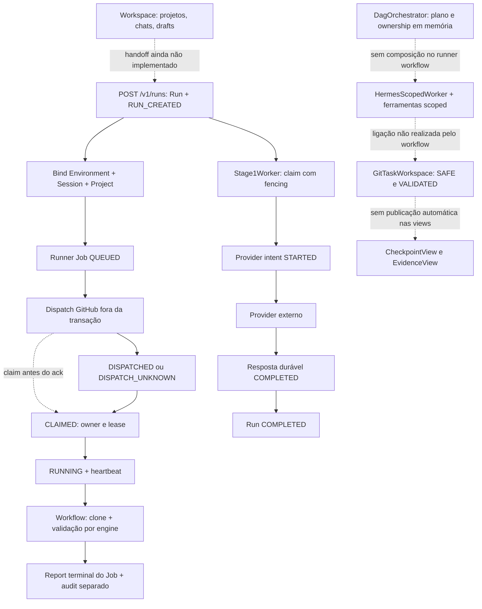

# AMODEX — Tarefa 03: Durable Execution, Checkpoint, Recovery e Idempotência

**Conclusão: existem componentes duráveis reaproveitáveis, mas ainda não há uma cadeia única de recuperação Director → Worker → Validation → Run/Runner Job. Não autorizar replay automático com base apenas em expiração de lease.**

Base auditada: **`1ca72365a63c2134921de58224bc68f73add203e`**, HEAD remoto confirmado de `fix/ui-ux-timeout-regressions-v1`. Branch criada após verificar ausência local/remota: **`audit/checkpoint-recovery-v1`**. Data: **2026-11-07, America/Recife**.

Escopo de escrita: novos testes de caracterização, este relatório e evidências. Produção, código de aplicação, migrations, workflows, dependências e branches anteriores permaneceram inalterados. Não houve deploy, integração de branches AMODEX, inferência real, redispatch externo ou acesso a banco Neon. Os testes Git trabalham exclusivamente com repositórios temporários locais, inclusive os merges que os testes existentes de promoção realizam em suas próprias fixtures.

As quinze fontes solicitadas existem nessa revisão. Blob Git, último commit que tocou cada arquivo, SHA-256 e tamanho estão registrados no [manifesto de fontes](evidence/task03/source-manifest.json), junto das fontes complementares. Isso evita confundir código auditado com outra branch ou versão implantada.

## A. Fluxo real e relações atuais



As linhas pontilhadas são lacunas de composição, não ausência dos componentes. O workflow atual é principalmente uma reconstrução/validação de repositório; não executa o coding worker só porque o claim contém um objetivo.

### Transições observadas

| Etapa | Implementação real | Persistência/limite |
|---|---|---|
| 1. Criar Run | `api/app.py:create_run` → `PostgresRunRepository.create_run` | Uma transação cria `amodex_runs` e evento `RUN_CREATED`, com `revision`, `event_seq` e `fencing_token`. Cada POST cria novo UUID; não há chave de requisição nesse contrato |
| 2. Vincular sessão | `storage/environment.py:bind_run` | Valida projeto/environment/session e persiste `amodex_session_runs`; repetir o mesmo vínculo é aceito. É chamada separada da criação do Run |
| 3. Criar Job | `storage/environment_product.py:create_runner_job` | Verifica scope e estados ativos usando locks compartilhados; Job recebe IDs de Run/projeto/environment/session, perfil, classe e paths. Não recebe TaskPackage ou attempt de execução persistido |
| 4. Dispatch | `api/app.py:dispatch_environment_runner` e `runners/dispatch.py` | Commit do Job `QUEUED`, HTTP externo, depois marca `DISPATCHED`. Erro de dispatch é classificado conservadoramente como `DISPATCH_UNKNOWN`; sem redispatch automático |
| 5. Claim | `claim_runner_job` | `FOR UPDATE`; aceita `QUEUED`, `DISPATCHED` e `DISPATCH_UNKNOWN`; apenas um claimant vence. API exige `github_run_id`, mas repository ainda aceita `None` |
| 6. Running | `mark_running` | `CLAIMED` + lease válida → `RUNNING`; renova por dois minutos, sem exigir owner no método/endpoint/client |
| 7. Heartbeat | `heartbeat_runner_job` | Exige mesmo `github_run_id`, estado ativo e lease ainda válida; renova dois minutos. `heartbeat_count` não é fencing token. Workflow chama a cada 30 s em processo de fundo |
| 8. Executar | `.github/workflows/environment-runner.yml` | Clona o repositório default com depth 1; Godot executa import/teste opcional/MCP em cópia descartável, genérico executa `git fsck`. Não chama Director, Hermes ou GitTaskWorkspace. `TARGET_BRANCH` é exportada, mas não usada para checkout/checkpoint |
| 9. Eventos | `storage/postgres.py` + `storage/product.py` | Eventos de Run têm ordem e unicidade transacionais. Transições de Job usam row/audit, não a mesma sequência de Run; audits são frequentemente gravados depois do commit da transição |
| 10. Checkpoints | `git/task_workspace.py` | Código cria commit e publica branch/ref SAFE; VALIDATED exige evidência PASS para o mesmo SHA e workspace limpo. Isso existe, mas não é chamado pelo workflow de Environment |
| 11. Validação | Scoped validator, GitTaskWorkspace e PromotionGate | Validadores reais e gates existem. O report de Job, isoladamente, aceita COMPLETED sem commit/evidência; não é um gate de Validation |
| 12. Terminal | `report_runner_job` e endpoint `/report` | Persiste terminal do Job e limpa lease; audit em outra transação. Não atualiza `amodex_runs`, suas tasks ou checkpoints. Report duplicado retorna conflito |
| 13. Interrupção | Stage1, dashboard e workflow | Stage1 pode reaver claim expirado e classifica intent incerto sem repetir provider. Job expirado gera bloqueador visual, não nova tentativa automática. Workflow possui cleanup `always()`, mas report de erro usa `failure()`, sem caminho específico de cancelamento |

### Relação com Workspace e agente

`storage/workspace.py` persiste chats, mensagens, memórias, anexos e execution drafts. Essas entidades são úteis para contexto, mas `amodex_workspace_projects` e `amodex_projects` são namespaces/tabelas distintos; um chat/draft não se torna automaticamente uma Task. O próprio setter de draft rejeita `EXECUTED` com `DRAFT_EXECUTION_REQUIRES_RUN_HANDOFF`.

`TaskPackage` já descreve task/attempt/package revision, objetivo, base SHA, branch, scope, capabilities, validade e autoridade. `HermesScopedWorker` consome TaskPackage e Context Capsule e oferece somente read/search/patch/tests. O bridge registra eventos resumidos em um `event_sink` opcional, mas não instala um journal SQL obrigatório. O home Hermes é recriado, memória/context files automáticos ficam desabilitados e a conversa é inicializada novamente. Restaurar `.hermes` não é o mecanismo de recuperação implementado por esse wrapper.

`DagOrchestrator` executa ownership/capacity/dependências/correções e snapshot/restore. Uso encontrado em testes e benchmark Stage 5, sem integração de scheduling persistente no workflow Environment. O snapshot restaura inclusive tarefas RUNNING e tokens; o caller deve persistir e reconciliar esse estado, não apenas carregá-lo e presumir autoridade renovada.

## B. Funcionalidades reaproveitáveis e limites

| Mecanismo | Estado atual verificado | Reaproveitamento seguro |
|---|---|---|
| Run Events | PostgreSQL, `UNIQUE(run_id, seq)`, row lock, estado/revision/evento na mesma transação | Base do histórico canônico. Injeção de falha na gravação de evento reverte estado e revision |
| Revision/fencing de Run | Token aumenta em claim/reclaim e bloqueia dono/token antigos após takeover | Preservar o mecanismo, acrescentar validação de expiração e vincular a attempts explícitos. Revision incrementada não equivale a CAS fornecido pelo caller |
| Provider request intent | Estado NONE/STARTED/COMPLETED, chave e resposta duráveis por Run | Reutilizar classificação de ambiguidade; expandir para múltiplas operações por Task/Attempt, sem perder compatibilidade com o slot legado |
| Decisões/attempts de Model Intelligence | Inspeção de `storage/model_intelligence.py` e migration 0006: decision ligada à mensagem owner com unicidade; attempts STARTED/terminal e request_key persistidos, únicos por decision/attempt_number | Preservar esse registro especializado do chat. Model-route attempt não é TaskPackage.attempt_id nem lease de execução; vincular receipts por referência, sem criar outro sistema de roteamento |
| Lease de Runner Job | Row com owner, heartbeat, expiry; claim concorrente serializado | Reutilizar tabela e APIs. Acrescentar attempt/fence/revision e autenticação consistente; não considerar contagem de heartbeat como geração de autoridade |
| TaskPackage | Contrato serializável e autoridade scoped | Persistir versão/hash e referências a Task/Attempt; não gerar um segundo pacote específico para cada engine |
| DAG/OwnershipRegistry | Snapshot serializável; estados, contadores e leases em memória | Persistir plano e snapshot com controle de versão, mantendo o mesmo validador/orquestrador. Restore sozinho não revalida lease |
| ScopedWorkspaceTools | Scope, path safety, lease local e patch por hash/precondição + rename atômico | Reusar ferramentas; acrescentar autorização por attempt e recibo de operação. Dois registries locais não têm conhecimento mútuo |
| SAFE/VALIDATED | Git commit/ref fora do runner; evidência ligada ao SHA, limpeza e PASS exigidos | Reusar os gates e os objetos de contrato. Acrescentar receipt imutável, refs por attempt/seq e reconciliação da publicação parcial |
| CheckpointView/EvidenceView | Rows SQL duráveis, porém projeções mutáveis por upsert | Continuar como leitura/UI, derivadas do registro canônico. Não usá-las como prova autossuficiente de validação/recovery |
| Promoção Stage 4 | `amodex_promotions.idempotency_key UNIQUE`, intenção, Git CAS e reconciliação já existentes | Reusar o padrão e o PromotionGate; não declarar todo Git idempotente nem substituir esse subsistema por outro |
| Audit | Persistência SQL com actor/action/subject/detail | Tornar eventos de autoridade atômicos à transição. Conteúdo livre de audit não substitui recibos validados |

### O que um checkpoint atual consegue reconstruir

| Informação exigida | Fonte existente | Lacuna para recuperação completa |
|---|---|---|
| Objetivo | `Run.prompt`, TaskPackage.objective | Package e checkpoint não estão vinculados numa autoridade persistente única |
| Plano | TaskPlan.to_dict e DAG snapshot | Não há persistência SQL automática do plano/snapshot no caminho do Job |
| Etapa atual | Estado Run/Job e estados do DAG | Não há cursor de operação/etapa canônico por Task/Attempt |
| Arquivos modificados | Git tree/diff; WorkerReport.changed_files | Worktree não commitado pode se perder; manifesto precisa referir o SHA efetivamente durável |
| Commit | Git branch/refs e Checkpoint.commit_sha | Publicação e receipt ainda não são reconciliados atomicamente |
| Histórico relevante | Run Events, mensagens e audit | Eventos Hermes são resumidos/opcionais; não há recorte de contexto versionado vinculado ao checkpoint |
| Resultados de ferramentas | Resposta JSON e stdout/stderr do validator | Não são obrigatoriamente persistidos como artifacts/receipts por operação |
| Operações externas | Intent do provider e intent de promoção | Não existe um journal genérico para tools/dispatch/commits integrado à Task |
| Validação | ValidationEvidence com SHA e hashes; views persistentes | Hash sem conteúdo disponível não restaura artefato; report do Job não exige o gate de evidência |
| Próxima ação | Caller/código do worker | Ausente como suspensão/cursor estruturado e validado no checkpoint |

## C. Problemas confirmados e limites de prova

**Aprovação de um teste de caracterização significa reprodução do comportamento, inclusive quando ele é inseguro. Não significa aprovação funcional desse comportamento.** IDs abaixo são referências desta auditoria.

### CR-01 — P1: identidade não é exigida em todas as mutações do Job

- `mark_running` recebe somente `job_id`. Endpoint e client não enviam owner.
- `/report` aceita `github_run_id` ausente; repository compara owner somente quando o campo não é `None`.
- Testes: `/running` sem bearer é recusado, mas com bearer compartilhado aceita a transição sem prova do dono. Report com owner errado retorna 409; omitindo owner, o mesmo Job CLAIMED aceita COMPLETED sem commit/evidência. Report sem owner também é aceito em DISPATCHED antes de claim, nos três estados terminais.
- Pré-condição: caller com token de runner e acesso ao handler; **não é uma alegação de acesso público anônimo**. O gate privado adiciona outra barreira, analisada em CR-02.
- Corrigir antes de recovery: identidade obrigatória, principal restrito a job/attempt e fencing/lease em running, heartbeat e report. Conclusão administrativa antes de claim deve ser comando distinto e auditado, não um bypass opcional.

### CR-02 — P1: gate privado e autenticação de máquina não estão compostos

- `workspace_app.py` instala `access_gate.py`, que exige cookie de proprietário em todas as rotas exceto health/readiness/login/logout; bearer de runner não é reconhecido ali.
- Teste local com gate habilitado: bearer correto + identidade retorna 401 `Amodex access passcode required`; adicionando sessão sintética do proprietário, o claim chega ao handler e passa.
- O workflow não adquire cookie do proprietário. Portanto, com essa configuração, a credencial de máquina sozinha não permite executar o fluxo publicado no workflow.
- Não confirmado em produção: valores e composição efetivamente implantados não foram consultados. Correção proposta: composição explícita de principals humanos/máquina, com escopo mínimo; não abrir indiscriminadamente rotas `/v1` ou distribuir sessão humana ao runner.

### CR-03 — P1: claim pode vencer o reconhecimento de dispatch

- Claim aceita QUEUED. HTTP externo ocorre antes de `mark_dispatched`; tanto `mark_dispatched` quanto `mark_dispatch_unknown` exigem ainda QUEUED.
- Dois testes determinísticos executam claim dentro do fake de dispatch, antes de retorno normal ou erro ambíguo. Em ambos, endpoint retorna **500**, enquanto o Job fica corretamente CLAIMED pelo workflow rápido. O conflito não é tratado nesse trecho do endpoint.
- Locks protegem a row contra dois claims, mas não ordenam a transação com o serviço externo. O erro não deve despromover o estado nem incentivar novo dispatch.

### CR-04 — P1: lease de Run expirada não basta para rejeitar o dono antigo

- `_lock_owned_run` compara owner/token, mas não compara expiry. Há lease padrão de 30 s no claim e nenhuma renovação no Stage1Worker.
- Testes: dono com lease SQL expirada ainda faz transition; só é bloqueado depois de outro claim incrementar fence. Provider simulado expira a lease durante a chamada, retorna, e o worker antigo ainda persiste resposta e conclui Run.
- Contraste importante: **Runner Job** rejeita heartbeat, running e report após expiry, inclusive sem owner e sem novo claimant. Não confundir as duas implementações de lease.
- Corrigir autorização temporal e renovação do Run/Attempt antes de tarefas longas; fencing externo continua necessário para efeitos que já saíram do processo.

### CR-05 — P1 de controle de execução: falha do heartbeat de fundo não interrompe o trabalho

- O subshell sai com 1 ao primeiro erro; o step de lançamento já retornou sucesso. Nenhum supervisor/checagem de liveness desse PID impede os próximos steps.
- Dois testes executam os blocos shell reais de start/stop com executáveis locais simulados: tanto `RUNNER_LEASE_LOST` quanto timeout de transporte encerram o filho, mas não falham o lançamento nem impedem o marcador de trabalho posterior. Cleanup remove PID, inclusive quando o filho já terminou.
- Não foi executado GitHub Actions real: sobrevivência do processo entre steps, cancelamento duro da VM e limpeza pelo runner GitHub permanecem não verificados. O shell local demonstra ausência do vínculo de falha; não prova uma escrita remota depois da perda de lease. O workflow atual não faz push de projeto.
- `failure()` não é um protocolo de cancelamento/resultado ambíguo; `always()` tenta matar o PID conhecido, mas não há report específico para cancellation nem supervisão de grupos de subprocessos. Client reduz erros de transporte e erros de lease a `RunnerClientError`/exit 2; o shell trata ambos igualmente.

### CR-06 — P1: report terminal e audit não têm commit único/ack idempotente

- Injeção após commit terminal e antes de audit: HTTP 500, Job COMPLETED persistido, audit ausente. Retry retorna 409 e não repara o registro.
- Mesmo report duplicado após sucesso também retorna `RUNNER_JOB_TERMINAL_CONFLICT` em vez de devolver recibo estável. Não altera o terminal duas vezes, mas o protocolo não permite distinguir perda do ack de falha da operação.
- Report completo não conclui Run nem valida Task/Checkpoint: teste mantém Run QUEUED e só `RUN_CREATED`. Isso caracteriza a fronteira entre dois fluxos; não deve ser resolvido copiando cegamente estado terminal de Job para Run.

### CR-07 — P1 para recuperação: repetição de criação/dispatch não tem identidade lógica estável

- Repetir o mesmo POST de Job cria outro job_id e executa outro fake de dispatch. Um Run pode legitimamente ter vários Jobs, mas repetir uma requisição perdida não deve ser confundido com nova intenção do usuário.
- `RunnerDispatchError` evita redispatch automático do mesmo Job em resultado ambíguo, o que é correto. Essa proteção não deduplica novo POST nem prova deduplicação pelo GitHub.
- Gemini e adapter OpenAI-compatible padrão recebem `request_key` no Python, mas dois valores diferentes geram os mesmos headers/payload em stubs HTTP. Não há contrato externo de deduplicação nesses caminhos. Não repetir chamada desconhecida alegando que a chave local a torna idempotente.

### CR-08 — P2: publicação de checkpoint pode ficar parcial

- `commit_safe_checkpoint` faz commit, push da branch e push da ref SAFE em comandos separados, e só depois retorna o Checkpoint.
- Falha simulada no segundo push: código já está durável na branch remota local, ref SAFE não existe e caller não recebe Checkpoint. Repetição falha por não haver nova alteração autorizada.
- Os bytes não foram perdidos: estão no Git remoto da fixture. A lacuna é recibo/descoberta/reconciliação e atomicidade entre Git e metadata. Não declarar o commit inseguro só porque a ref auxiliar faltou, nem declarar a publicação completa.

### CR-09 — P2 de arquitetura: snapshots/projeções não são a autoridade integrada de recovery

- Uma CheckpointView SAFE pode ser substituída por VALIDATED com outro SHA e sem evidence_ids; é uma projeção mutável, não um ledger de prova.
- Snapshot de DAG persistido pelo teste em JSON restaura em processo novo, mas conserva RUNNING e ownership/fence anteriores, sem reconciliar liveness/lease/autoridade. Em produção o persistidor desse snapshot não está instalado no caminho do Job.
- Patch repetido com hash antigo é recusado e não reaplica a escrita; isso é uma precondição útil, não um recibo idempotente. Outra instância de PathLeaseRegistry adquire a mesma path porque os registros são locais.

### CR-10 — P3: teste existente espera a rejeição antiga de claim

`test_godot_environment_dispatch_claim_report_usage_and_dashboard` envia claim sem `github_run_id` e espera 401. O contrato atual exige o query field e FastAPI retorna 422 antes de executar `authorize_runner`. A requisição continua recusada; essa falha de teste não demonstra bypass de autenticação. Nenhum arquivo original de teste foi alterado nesta auditoria. Ajustar contrato/expectativa explicitamente numa tarefa de correção.

## D. Testes, comandos e evidências

Ambiente reutilizado: Python 3.13.5, pytest 9.0.2, PostgreSQL 17 local; sem pacote novo. Ferramentas usadas: terminal, Git/GitHub, API TestClient, SQL, subprocessos, Git bare fixtures, executáveis shell e HTTP stubs. Browser/MCP/Render não foram necessários: não houve mudança UI nem teste remoto. Provider/Actions reais não foram acionados.

| Execução | Aprovados | Falhas | Erros | XFAIL/skips |
|---|---:|---:|---:|---:|
| Suites existentes principais | 225 | 1 (CR-10) | 0 | 0 |
| Promoção/idempotência e isolamento de Environment adicionais | 4 | 0 | 0 | 0 |
| Novas caracterizações | 25 | 0 | 0 | 0 |
| **Total de casos distintos executados** | **254** | **1** | **0** | **0** |

Comandos, em `/workspace/Amodex`, com `AMODEX_TEST_DATABASE_URL=postgresql://amodex@127.0.0.1:55432/amodex_qa_task03`:

```bash
.venv/bin/pytest tests/unit tests/contract \
  tests/integration/test_stage1_crash_recovery.py \
  tests/integration/test_stage1_vertical_slice.py \
  tests/integration/test_stage1_migrations.py \
  tests/integration/test_stage1_provider_failures.py \
  tests/integration/test_stage2_checkpoint_lifecycle.py \
  tests/integration/test_stage2_scoped_tools.py \
  tests/integration/test_stage3_dag_orchestration.py \
  tests/integration/test_stage4_stale_crash.py \
  tests/integration/test_postbaseline_environment_product.py \
  --junitxml=artifacts/qa/task03/existing.xml -ra

.venv/bin/pytest tests/integration/test_stage4_promotion_lifecycle.py \
  tests/integration/test_postbaseline_environment_storage.py \
  --junitxml=artifacts/qa/task03/additional-existing.xml -ra

.venv/bin/pytest tests/integration/test_checkpoint_recovery_audit.py \
  tests/unit/test_runner_heartbeat_audit.py \
  tests/unit/test_provider_request_key_audit.py \
  --junitxml=artifacts/qa/task03/characterization.xml -ra
```

A suíte principal foi coletada antes da criação dos novos arquivos, portanto os 25 casos novos não estão duplicados no primeiro total. O conjunto principal inclui os testes obrigatórios de crash, checkpoint lifecycle, DAG e heartbeat. Warning existente de Starlette/httpx continua sendo depreciação, não falha.

Uma execução combinada final no commit de testes **`5822551`** confirmou novamente **254 aprovados e 1 falha em 255 casos**, sem erros, XFAIL ou skips. Ela não é somada à contagem anterior. Com a mesma variável de banco local, o comando final foi:

```bash
.venv/bin/pytest tests/unit tests/contract \
  tests/integration/test_stage1_crash_recovery.py \
  tests/integration/test_stage1_vertical_slice.py \
  tests/integration/test_stage1_migrations.py \
  tests/integration/test_stage1_provider_failures.py \
  tests/integration/test_stage2_checkpoint_lifecycle.py \
  tests/integration/test_stage2_scoped_tools.py \
  tests/integration/test_stage3_dag_orchestration.py \
  tests/integration/test_stage4_stale_crash.py \
  tests/integration/test_postbaseline_environment_product.py \
  tests/integration/test_stage4_promotion_lifecycle.py \
  tests/integration/test_postbaseline_environment_storage.py \
  tests/integration/test_checkpoint_recovery_audit.py \
  --junitxml=artifacts/qa/task03/final-combined.xml -ra
```

### Matriz de falhas controladas

| Cenário solicitado | Execução/evidência | Resultado e limite |
|---|---|---|
| Worker morto antes da operação | Stage1 crash subprocess SIGKILL antes de intent | Replacement realiza uma chamada simulada; fence antigo rejeitado |
| Worker morto após início registrado | SIGKILL após STARTED | UNKNOWN_OUTCOME, zero chamadas do replacement |
| Resposta recebida, completion não gravada | Injeção antes de persistência da resposta | Intent permanece STARTED; após expiry e novo worker não há segunda chamada |
| Heartbeat interrompido | Shell real com erro de lease/transporte simulado | Filho termina; lançamento/trabalho posterior não falham; PID limpo |
| Lease expirada | SQL determinístico, sem depender de sleep | Job rejeita mutações/claim; Run ainda admite dono antigo até takeover (CR-04) |
| Runner antigo tenta concluir | Job expired report; Run old fence após reclaim | Ambos rejeitados nesses cenários; late Run sem takeover ainda é aceito, documentado separadamente |
| Dois claimants no mesmo Job | Duas conexões/thread barrier | Exatamente um claim vence; outro NOT_CLAIMABLE |
| Dispatch ambíguo | Fake existente e race fake | UNKNOWN sem retry no fluxo normal; claim antes do ack/erro produz 500 (CR-03) |
| Checkpoint antes da interrupção | Git SAFE/VALIDATED, destruir clone e reconstruir | Código e validação sobrevivem em Git remoto local; metadata de agente continua externa |
| Reconstruir dados duráveis | Run repository novo, clone novo, processo novo para DAG | Resposta durável reutilizada sem provider; código recuperado; DAG JSON precisa reconciliação de autoridade |

A primeira execução dos novos testes tinha uma injeção incompatível com dataclass `slots` em GitTaskWorkspace (18 aprovados, 1 falha e 1 erro de teardown). O teste foi corrigido para interceptar o método na classe; não houve alteração no produto. O resultado final contém todos os 25 casos executados com sucesso. Casos novos não usam XFAIL para tornar o relatório verde: suas asserções descrevem o comportamento observado e os defeitos permanecem abertos.

Evidências versionadas: [results.json](evidence/task03/results.json), [final-combined.xml](evidence/task03/final-combined.xml), [existing.xml](evidence/task03/existing.xml), [additional-existing.xml](evidence/task03/additional-existing.xml), [characterization.xml](evidence/task03/characterization.xml). Logs temporários em `artifacts/qa/task03/`, fora do Git. Somente fixtures e credenciais sintéticas; sem cookies, tokens reais ou corpos privados.

## E. Arquitetura proposta — especificação, não implementação

Esta seção detalha a integração dos contratos de [PERSISTENCE_AND_RECOVERY.md](../PERSISTENCE_AND_RECOVERY.md), [RUNTIME_CONTRACTS.md](../contracts/RUNTIME_CONTRACTS.md) e [GIT_LIFECYCLE.md](../GIT_LIFECYCLE.md). Não substitui os componentes existentes nem afirma que as tabelas abaixo já existem. PostgreSQL permanece autoridade; Git conserva código e checkpoints. Uma infraestrutura adicional de armazenamento só deve ser discutida se limites medidos dos artifacts justificarem.

### E1. Identidades e relações

```text
Project + Environment + Session
  -> Run
     -> ExecutionPlan(revision, digest)
        -> Task(TaskPackage.task_id)
           -> Attempt(TaskPackage.attempt_id, fence, lease_owner, lease_expiry)
              -> RunnerJob(launch envelope)
                 -> DispatchOperation / GitHub workflow run + run_attempt
           -> Checkpoint(sequence, attempt, code SHA, context/plan refs, evidence)
           -> LogicalOperation
              -> OperationAttempt / receipt / reconciliation
```

- Run é agregado durável e superfície pública; suas events continuam canônicas.
- Task é nó lógico do plano. Attempt é uma autorização concreta e não pode ser reaproveitada após perda definitiva. Job é o envelope de execução do Attempt, não o TaskPackage nem o checkpoint.
- Attempts especializados de Model Intelligence continuam como tentativas de chamada/rota dentro de operações do Provider System. Não são renomeados para TaskAttempt nem usados como substituto de autorização do worker; mapear IDs e receipts sem duplicar sua seleção/contabilização.
- Persistir o TaskPackage emitido, package revision, hash e vínculos Run/Task/Attempt. `github_run_id` + `GITHUB_RUN_ATTEMPT` identificam a execução externa; não substituem o UUID do Attempt ou seu fence.
- Novo recovery gera novo attempt_id/job_id e fence maior. Reconcile da mesma chamada de dispatch não gera nova execução; só descobre/acknowledge o que já existe.
- Boundaries de scope/capability continuam nos contratos comuns. Environment Adapter decide capacidades/provisionamento, Provider System decide rota/custo/transporte; nenhum deles vira uma segunda autoridade de scheduling.

### E2. Estado, sequência e fencing

Adicionar persistência de `tasks`, `attempts`, plano versionado, checkpoints e operações às camadas storage existentes, com nomes e migrations a definir na implementação. Não usar views de UI como essas tabelas de autoridade.

- Cada entidade de autoridade tem revision; eventos possuem sequência única por agregado. Transição + evento + audit/receipt correspondente devem ser uma transação.
- Claim atômico incrementa fence monotônico por Task e aponta `current_attempt_id`. Locks/CAS garantem capacidade e um writer por path entre processos, reaproveitando a lógica de conflito do OwnershipRegistry.
- Toda mutação exige principal autorizado, job/attempt corretos, current fence, estado permitido e lease válida no **relógio do banco no momento da autorização**. Atenção a espera por lock: `NOW()` é fixado no início da transação; transações curtas e relógio corrente devem evitar validar uma lease já expirada após longa espera.
- Aplicar fence também às ferramentas e commits/publicações; um token só em SQL não impede efeito que já foi enviado a serviço externo. Git usa expected SHA/CAS; providers sem fencing externo requerem journal/reconciliação.
- Eventos/receipts tardios de tentativa revogada não podem concluir o Task. Uma observação tardia pode ser guardada em quarentena, sem autoridade de transição, para o reconciliador atual verificar a operação externa.

### E3. Operações externas e idempotência

Reutilizar o padrão de intenção/reconciliação de PromotionGate e o provider intent existente. Ledger mínimo por operação lógica:

```text
scope + logical_operation_id (único)
run_id, task_id, issuing_attempt_id, fence, capability
request_digest, expected_versions, idempotency_capability
state: PREPARED | DISPATCHED | SUCCEEDED | FAILED_KNOWN | UNKNOWN_OUTCOME
receipt_ref/hash, dispatched_at, completed_at, reconciliation_kind
```

1. Persistir PREPARED com dados canônicos e referências a credenciais, nunca valores.
2. Antes de enviar efeito, validar autorização e persistir DISPATCHED. Crash entre essa gravação e envio é conservadoramente ambíguo; não otimizar a segurança presumindo que o envio não ocorreu.
3. Receipt válido + transição de estado + audit na mesma transação. Repetição com mesma chave/digest devolve o receipt estável; chave reaproveitada com payload diferente retorna conflito.
4. Reconciliar fontes externas sem repetir mutação. Não chamar um provider outra vez só porque seu `request_key` local existe. Classificar capacidade de deduplicação por adapter com prova específica; suporte desconhecido equivale a não suportado.

| Operação | Contrato de retomada proposto |
|---|---|
| Leitura/consulta de status | Pode ser repetida sob scope vigente; não conceder autoridade de escrita por isso |
| Patch | operation_id + hash antes/depois, path e recibo. Se hash atual é after e receipt/intenção correspondem, reconhecer sem reaplicar; se before, exigir prova de não execução e nova autorização; terceiro valor bloqueia para revisão |
| Commit/publicação | Registrar parent/tree/commit SHA e refs esperadas. Consultar branch/refs e objetos; aproveitar commit já publicado, sem gerar commit novo ou force-push para mascarar conflito |
| Provider | STARTED/DISPATCHED sem completion implica UNKNOWN. Só reconciliação documentada ou autorização explícita permite nova inferência; nenhuma garantia de exactly-once universal |
| Dispatch workflow | Chave lógica da solicitação, correlation IDs nos inputs, intenção antes do HTTP. Ack deve aceitar monotonicamente Job já CLAIMED/RUNNING. HTTP 204 não fornece identidade de workflow nem prova que não houve execução duplicada |
| Report terminal | Persistir digest/receipt por Attempt. Mesmo payload devolve mesmo ack; divergência retorna conflito. Repetição histórica não renova lease nem altera o Task atual |
| Promoção | Manter unique idempotency_key, expected target SHA, gates e reconcile já implementados; não refazer essa autoridade |

Uma outbox SQL pode ligar decisão de scheduling e despacho sem novo broker. Ela não deve redispatch uma operação marcada DISPATCHED apenas por não ter ack. Intake de CreateRun/CreateJob precisa de chave idempotente e digest para distinguir retry de intenção nova.

### E4. Checkpoint persistente e protocolo Git/DB

Checkpoint canônico imutável: `checkpoint_id`, Run/Task/Attempt, `checkpoint_seq`, schema version, fence de emissão, package/plan revisions e hashes, repository/base/commit SHA, ref imutável por attempt/seq, tree/diff manifest, event cursor, operation cursor, `context_ref/hash`, validator evidence IDs/hashes e `next_action` estruturada. Constraints mínimas: IDs/seq únicos por Task; checkpoint não referencia outra Task/Attempt/Run ou evidência de outro SHA.

Separar **classe de validação** (WIP/SAFE/VALIDATED, já existentes) de **estado de publicação** (intenção, Git observado, metadata confirmada, desconhecido). Um campo não deve fingir o outro.

- Commit/tree primeiro identificados; registrar intenção de publicação e refs/SHA esperados.
- Publicar objetos/refs via GitTaskWorkspace com precondição, depois confirmar observando o remoto e gravar receipt SQL. Não há transação distribuída Git/PostgreSQL; a segurança vem da reconciliação.
- Crash depois do push: reconciliar branch/ref/commit conhecidos e completar metadata; não exigir nova edição nem inventar outro checkpoint.
- SAFE comprova snapshot de código coerente e durável; VALIDATED acrescenta evidência PASS ligada ao exato SHA/validator. Nenhum deles, sozinho, prova que efeitos externos foram reconciliados ou que a Task inteira terminou.
- Restaurar clone com checkpoint SHA conhecido, conferir hashes/ref e reemitir nova TaskPackage/Attempt sob autorização vigente; não usar token velho nem herdar confiança de um worktree sobrevivente.

### E5. Persistência e reconstrução do contexto

Persistir snapshots estruturados e versionados de plano, DAG/ownership e contexto: objetivo, decisões/assunções verificáveis, etapa, próximo passo, manifests de arquivos, mensagens relevantes permitidas, resultados de ferramentas, operações em aberto e evidências. Referenciar Git blobs/artefatos por hash em vez de duplicar todo o repositório em cada snapshot.

Reusar ScopedContextCapsule/Context Engine e TaskPackage. O pacote reidratado deve conferir Task/Run/Attempt, expected SHA, scope, hashes e versões de ferramentas/validator/model policy antes de chamar Hermes. Não depender de transcript opaco, estado de raciocínio interno ou arquivos locais `.hermes` para consistência. Remover segredos de contexto/receipts; credenciais continuam por referência e permissões novas.

Snapshot de DAG carregado é apenas estado histórico: tarefas RUNNING exigem reconciliação com Attempts/leases atuais. Não liberar ownership e marcar todas READY no startup. Plano e contexto alterados materialmente exigem nova revisão/validação, mantendo o histórico antigo.

### E6. Classificação e decisão obrigatória de recovery

Não sobrecarregar `FAILED` com todas as situações; manter estado operacional e classificação de recuperação separados quando necessário, com reason codes duráveis.

| Situação | Classificação/ação autorizada |
|---|---|
| Heartbeat recente + lease válida | ACTIVE; continuar somente sob scope/fence vigentes |
| Heartbeat atrasado, ainda sem prova de expiry | HEARTBEAT_LOST/SUSPECT; consultar autoridade. Timeout de transporte não prova perda; suspender novos efeitos enquanto não puder provar autorização |
| Lease expirada/revogada ou owner/fence divergente | EXPIRED/LOST; parar novos efeitos e encerrar subprocessos sob controle. Não aceitar terminal antigo |
| Receipt e validação final duráveis | COMPLETED; devolver resultado/ack existente, sem repetir efeitos |
| Erro conhecido com prova de não execução ou falha terminal | FAILED_KNOWN; registrar motivo. Nova ação só pela política/autoridade, não retry implícito |
| Dispatch/provider/ferramenta sem resultado confirmado | UNKNOWN_OUTCOME; reconciliar status/receipt externo ou bloquear para intervenção |
| Snapshot íntegro, escopo atual e zero operações desconhecidas; etapa segura provada | RECOVERABLE; controlador pode emitir novo Attempt/Package e continuar a partir da fronteira segura, não necessariamente repetir a última operação |
| Operação não reconciliável, drift de SHA/escopo, conflito de receipt ou evidência ausente | MANUAL_REVIEW_REQUIRED; nenhuma repetição automática |

Detector de abandonados consulta estado/expiry/último heartbeat e registros externos. Marcar suspeita/expiração é atômico e auditado; não é fila de redispatch. A decisão de recovery usa locks/CAS para um coordenador vencer e verifica controles PAUSED/CANCELLED, dependências, budget e capacidades antes de novo Attempt.

Heartbeat precisa de supervisor ligado ao trabalho. Perda confirmada cancela grupo de processos e proíbe efeitos novos. Falha de transporte também não concede autorização: pausar efeitos até consulta confiável ou expiry, sem converter erro de rede em sucesso nem apagar resultado incerto. Limpeza `finally`/traps e cancelamento Actions são medidas complementares, nunca substitutos do fence.

### E7. Gate de conclusão recuperada

Antes de concluir Task/Run: conferir Attempt atual e lease, operações reconciliadas, workspace limpo e scope, commit esperado, artifacts íntegros, validators requeridos executados para o SHA atual e critérios de aceitação satisfeitos. Mudança de base exige análise de freshness/reintegração pelo mecanismo existente e nova validação; não promover checkpoint antigo por aparência.

Persistir resultado de Task + evento + audit + receipt em transação. Atualizar CheckpointView/EvidenceView/TaskView a partir dessa autoridade. Run só conclui quando seu plano e política de validação permitem, não por um Job enviar COMPLETED. Promotion continua uma decisão/gate separado com expected target SHA e autorização própria.

## F. Plano modular de implementação — ainda não executado

### R1. Compor autenticação humana/máquina e fechar lacunas de identidade

- **Objetivo:** resolver CR-01/02 sem ampliar acesso privado.
- **Dependências:** nenhuma implementação nova; manter contratos e repros desta auditoria.
- **Arquivos:** `api/access_gate.py`, `api/app.py`, `environments/product.py`, `runners/client.py`, workflow e testes de autenticação/runner.
- **Alterações:** principal de runner restrito a job/attempt; owner obrigatório nas mutações; separar cancelamento administrativo; preservar sessão humana como autoridade distinta.
- **Riscos:** expor rotas privadas por exceção ampla; quebrar clients legados sem rollout explícito.
- **Testes:** bearer correto sem cookie acessa somente rotas autorizadas; ausência/owner errado/attempt errado negados; proprietário humano e health continuam corretos.
- **Aceitação:** CR-01 passa a rejeitar identidade ausente e CR-02 permite o runner autorizado sem sessão humana; nenhum acesso extra a workspace/segredos.

### R2. Uniformizar attempts, leases, fencing e atomicidade terminal

- **Objetivo:** resolver CR-04/06 e estabelecer a autoridade de cada tentativa.
- **Dependências:** R1 e contrato de IDs aprovado.
- **Arquivos:** contratos, storage `postgres.py`/`environment_product.py`/`product.py`, migrations locais futuras, Stage1Worker e APIs.
- **Alterações:** persistir Attempt/geração; checks de expiry no relógio corrente; revision/CAS; Run/Job/result/audit/receipt ligados em transações apropriadas; duplicate ack estável.
- **Riscos:** deadlock, leases longas mascarando falha, confundir Run com Job e reaproveitar tentativa velha.
- **Testes:** expiry sem takeover rejeita completion; two claimants; takeover; rollback; terminal commit antes de ack; mesmo receipt repetido e digest divergente.
- **Aceitação:** tentativa expirada nunca confirma resultado novo; late observations ficam sem autoridade; report repetido não duplica nem some do audit.

### R3. Resolver dispatch/claim e intake idempotente

- **Objetivo:** resolver CR-03/07 com progresso monotônico e intenção durável.
- **Dependências:** R1/R2.
- **Arquivos:** `api/app.py`, `runners/dispatch.py`, storage de Job/operação e workflow.
- **Alterações:** chave lógica de POST, digest, intenção/outbox SQL; reconhecimento monotônico após claim; correlação e reconciliação do workflow. UNKNOWN não é elegível a novo envio automático.
- **Riscos:** falso pressuposto de exactly-once do GitHub; reenvio depois de resposta perdida.
- **Testes:** claim antes de ack e antes de erro, timeout após aceitação, HTTP repetido, corpo divergente, dois controladores.
- **Aceitação:** races não retornam 500 indevido nem regridem CLAIMED/RUNNING; mesma requisição gera um Job/uma intenção; resultado incerto bloqueia redispatch.

### R4. Supervisionar heartbeat, cancelamento e subprocessos

- **Objetivo:** resolver CR-05, preservando distinção entre rede e perda de autoridade.
- **Dependências:** R1/R2.
- **Arquivos:** `runners/client.py`, workflow, bridge/runtime e testes shell.
- **Alterações:** códigos estruturados, supervisor/traps/process groups, interrupção de novas ferramentas quando autorização não é demonstrável; cleanup em todos os caminhos.
- **Riscos:** sobreviver subprocesso órfão; matar trabalho legítimo e depois repeti-lo; confiar apenas em sinal local.
- **Testes:** erro 409, timeout, DB indisponível, SIGTERM/SIGKILL local, cancelamento simulado e tentativa de report tardio. Actions real só em tarefa explicitamente autorizada.
- **Aceitação:** nenhum efeito novo passa sem lease/fence; erro de rede não vira retry de provider; cleanup observável e resultado desconhecido preservado.

### R5. Persistir plano, TaskPackage e snapshots de contexto

- **Objetivo:** compor Director/Worker sem reconstruir estado a partir de projeções.
- **Dependências:** R2.
- **Arquivos:** `director/orchestrator.py`, modelos/Context Engine, `runtime/hermes_worker.py`, storage/migrations futuras.
- **Alterações:** repositório de plano revisionado e packages imutáveis; persistência de snapshot + cursor; adapter de reidratação e reconciliação de ownership.
- **Riscos:** snapshot inconsistente com eventos, segredo no contexto, reautorizar RUNNING histórico.
- **Testes:** restart em processo novo, plan drift, hashes alterados, package expirado, tentativa substituída e dois restauradores.
- **Aceitação:** restart recupera estado verificável e próximo passo sem herdar autoridade velha ou liberar todos os nós.

### R6. Journal de ferramentas/providers e recibos de operação

- **Objetivo:** generalizar o padrão já provado de intent sem duplicar Provider System.
- **Dependências:** R2/R3; vinculação a Task/Attempt de R5.
- **Arquivos:** storage, `tools/scoped_workspace.py`, `runtime/worker.py`, `runtime/hermes_worker.py`, contratos/adapters.
- **Alterações:** ciclo PREPARED/DISPATCHED/receipt, digest e precondições; operações lógicas estáveis entre tentativas; compatibilidade do provider intent legado.
- **Riscos:** marcar operação como não executada depois de envio; alegar suporte externo à chave que não existe.
- **Testes:** crash antes/depois do intent, antes do receipt, resultado retornado sem commit, patch já aplicado/conflitante, duplicação por mesmo/diferente digest.
- **Aceitação:** ambiguidade sempre durável; nenhuma segunda chamada não idempotente sem reconciliação/autorização; testes CR-07 distinguem registro local de contrato externo.

### R7. Checkpoint/evidência canônicos e publicação reconciliável

- **Objetivo:** resolver CR-08/09 para código e metadata, preservando SAFE/VALIDATED.
- **Dependências:** R2/R5/R6.
- **Arquivos:** `git/task_workspace.py`, contratos, storage canônico, product views e backend de promoção existente.
- **Alterações:** checkpoint_seq, refs por Attempt/seq, manifest/cursor/context hash; intenção antes do push e reconciliação de branch/ref já publicadas; armazenar artifacts/receipts necessários.
- **Riscos:** tratar Git/SQL como transação única, perder referência do código durável, aceitar evidencia mutável como autoridade.
- **Testes:** falha em cada fronteira de commit/push/ref/metadata, destruição do clone, objeto ausente, SHA divergente, evidência de outro Task/commit.
- **Aceitação:** publicação parcial é descoberta sem nova edição; VALIDATED só nasce de prova íntegra no SHA correto; views não autorizam conclusão.

### R8. Coordenador de reconciliação e recovery conservador

- **Objetivo:** aplicar a matriz E6 usando os mesmos componentes Core/Execution/Providers.
- **Dependências:** R1–R7.
- **Arquivos:** runtime/orquestrador/storage existentes e interfaces de reconciliadores; nenhum scheduler paralelo por engine.
- **Alterações:** detectar abandonados, classificar operações, emitir nova tentativa somente em fronteira segura, preservar PAUSED/CANCELLED e registrar intervenção manual.
- **Riscos:** replay por expiry, dois coordenadores, reviver tentativa que ainda executa efeito externo.
- **Testes:** todos os dez cenários da auditoria em matriz de falhas; duplicação de coordenadores; conflito externo e retomada segura sem provider real.
- **Aceitação:** expiry sozinho nunca dispara replay; attempt antigo não conclui; UNKNOWN sem prova permanece bloqueado; context/package/checkpoint revalidados.

### R9. Integrar Validation/Run e projetar estados de recuperação

- **Objetivo:** ligar o pipeline real e tornar estado compreensível sem confundir projeção e autoridade.
- **Dependências:** R5–R8.
- **Arquivos:** `api/app.py`, `api/workspace_routes.py`, product/storage views, UI existente e testes API/E2E.
- **Alterações:** handoff autorizado Draft→Run/Task; completion gate comum; projeções para ativo/suspeito/expirado/ambíguo/revisão manual e referências a evidências.
- **Riscos:** chat executar sem autorização; Job COMPLETED concluir Run sem validação; UI sugerir retomada perigosa.
- **Testes:** handoff negado/aceito, gates de evidência, projeções após restart e navegação em quatro viewports reaproveitando Playwright.
- **Aceitação:** um único fluxo Director→Worker→Validation comprovado; estados UI derivados e nenhuma ação de replay implícita.

### R10. Alinhar testes legados e matriz de aceitação

- **Objetivo:** resolver CR-10 e transformar caracterizações inseguras em regressões de rejeição após cada correção.
- **Dependências:** cada correção correspondente; CR-10 pode ser tratado independentemente.
- **Arquivos:** testes existentes de Environment/Runner, novos testes desta branch e CI já existente.
- **Alterações:** expectativas explícitas de schema/autenticação; marcar quais testes são caracterização vs gate de segurança; substituir asserção de aceitação insegura somente depois da correção verificada.
- **Riscos:** mudar testes para ocultar falhas ou declarar arquitetura pronta apenas por contagens verdes.
- **Testes:** executar suites obrigatórias, matrizes de falha e verificação de artifacts/contagens; sem serviços pagos ou produção.
- **Aceitação:** cada risco fechado tem evidência positiva/negativa; nenhuma regressão vira skip; relatório distingue implementação, simulação e operação externa não verificada.

## Decisão de continuidade

Prioridade: **R1–R4 antes de habilitar trabalho com efeitos e retomada automática; depois R5–R7; só então R8/R9**. Manter o comportamento conservador de provider intent e promoção. Não redispatch por expiry nem inferir sucesso pela existência de uma view ou de um SHA enviado pelo runner.

Esta tarefa entrega auditoria, 25 caracterizações e projeto modular; **não implementa Recovery**, não corrige silenciosamente os problemas encontrados e não comprova cancelamento Actions/Hermes real, comportamento de providers reais ou estado da produção. Essas limitações são condições de planejamento, não autorização para repetir efeitos desconhecidos.
